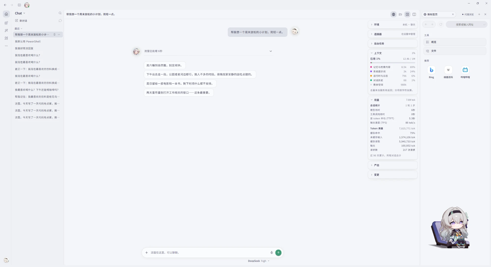
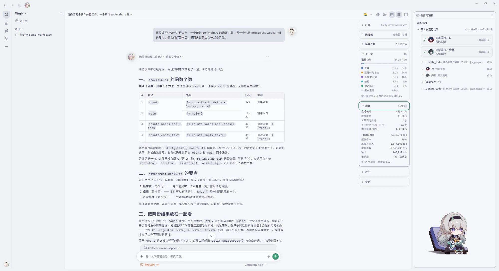
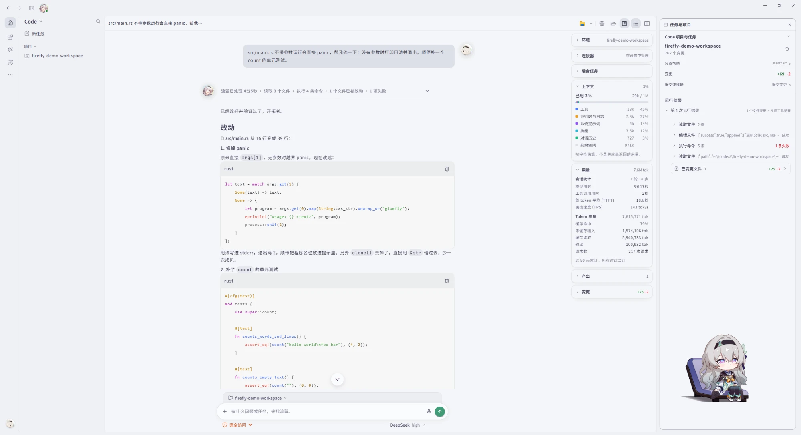
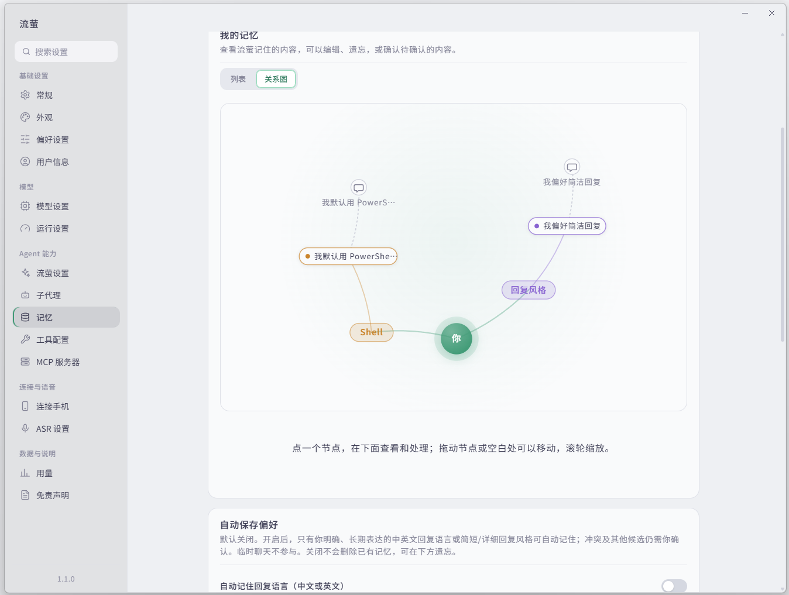
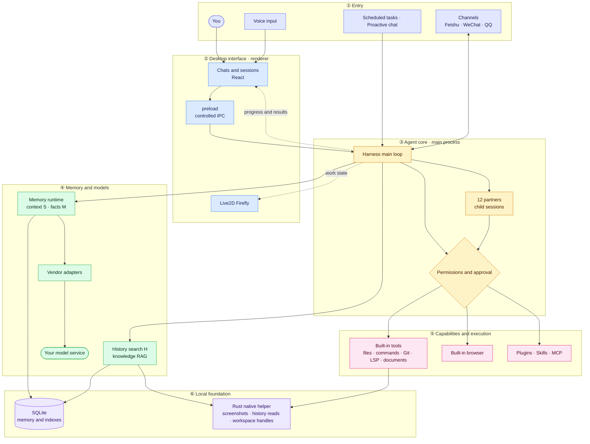

<p align="center"><a href="./README.md">简体中文</a> · <b>English</b></p>

<p align="center">
  <picture>
    <source media="(prefers-color-scheme: dark)" srcset="./readme-assets/firefly-banner-dark.en.gif">
    
  </picture>
</p>

<p align="center">
  <a href="https://github.com/Firefly-0423/Firefly-Agent/releases/latest"></a>
  
  
  <a href="https://hotarufirefly.online"></a>
</p>

<h3 align="center">Chats with you. Gets things done.</h3>

<p align="center">A Windows Live2D desktop companion featuring Firefly from Honkai: Star Rail.<br>She chats with you, reads and writes files, changes code and runs commands, and splits work with 12 partners. You see every step she takes and everything she needs you to approve.</p>

<p align="center">
  <a href="https://github.com/Firefly-0423/Firefly-Agent/releases/latest"><b>Download for Windows</b></a> · <a href="https://hotarufirefly.online">Website and live demo</a> · <a href="#-features">Features</a> · <a href="#-security-and-privacy">Security</a> · <a href="#-run-from-source">Run from source</a> · <a href="https://github.com/Firefly-0423/Firefly-Agent/issues">Issues</a>
</p>

---

## ✨ At a glance

- **A persona, with boundaries**: conversations follow Firefly's canon and voice; tools, permissions, approvals and honest results never loosen because of the character's tone.
- **Three modes, one window**: Chat for company, Work for tasks, Code for code, each with its own prompts and tools.
- **Firefly and 12 partners**: in Work and Code, Firefly splits a task between the partners suited to it, runs them in parallel, then checks and combines what comes back; each partner can use its own model.
- **Memory stays local**: personal memory and history search live in SQLite on your machine, and the memory database key is protected by Windows DPAPI.
- **Asks before it acts**: writing files, running commands and going online run under permission levels, need your approval and can be cancelled at any time.
- **Extensible**: the Skills market, the plugin market, the plugin SDK, MCP servers and external channels are all optional.

## 📸 Screenshots

<p align="center"><b>💬 Chat · Desktop companion</b></p>
<p align="center"></p>
<p align="center"><sub>Talking with Firefly. The built-in browser is open on the right, the overview cards show context and usage (the total comes from the provider), and the Live2D Firefly sits on the desktop.</sub></p>

<p align="center"><b>📋 Work · Tasks</b></p>
<p align="center"></p>
<p align="center"><sub>Firefly splits a task between two partners working in parallel (Blade counts the functions, Dan Heng summarizes the notes), checks their answers against the sources, and combines them. Each partner's run result is on the right.</sub></p>

<p align="center"><b>💻 Code · Workspace</b></p>
<p align="center"></p>
<p align="center"><sub>Fixing a panic and adding a test in a bound project. The run folds into one summary line (files read, commands run, what changed, what failed); the branch, changes and run results are on the right.</sub></p>

<p align="center"><b>🧠 Memory graph</b></p>
<p align="center"></p>
<p align="center"><sub>Settings → Memory → Graph: you in the centre, linked to each category, each memory and the conversation it came from. Click a node to review it; drag and zoom to explore.</sub></p>

## 📥 Download and get started

1. Download `Firefly-Agent-Setup-<version>.exe` from [Releases](https://github.com/Firefly-0423/Firefly-Agent/releases/latest) and run it. It needs Windows 10 / 11 (x64). The release page lists the installer's SHA-256; check it with `Get-FileHash <file> -Algorithm SHA256`.
2. On first launch, create a **model profile** in Settings: the protocol, endpoint and model your service supports, plus your own credentials. OpenRouter has a preset. The installer includes no model service or account.
3. Pick **Chat / Work / Code**. Work and Code bind each task to a project folder; you can also create a project first with the "+" next to Projects in the sidebar.
4. Turn on tools, Skills, plugins or MCP as needed.

Want a look first? The live demo at [hotarufirefly.online](https://hotarufirefly.online) is the same interface. Its replies are scripted: no model calls, no network.

## 🧩 Features

### 💬 Chat: desktop companion

- Live2D Firefly: double-click expressions, dragging, idle motions, and a working expression while tools run.
- In-character chat, streamed replies, history; temporary chats stay out of history.
- The persona comes from layered prompts and lore entries (background, story, voice, canon quotes), triggered by topic rather than sent every turn.
- Optional **proactive chat**: speaks up sparingly by time of day, silence and unanswered messages, and stops when you do not reply.
- Desktop voice input (ASR): off, Mossland or Alibaba Cloud; the transcript fills the composer and is never sent automatically.

### 📋 Work: tasks

- Works with files, documents and knowledge: file read/write and patching, Word / Excel / PDF tools, web search and reading, downloads, scheduled tasks and calendar.
- **Delegation to partners**: Elio (planning), Himeko (architecture), Blade (implementation), The Herta (research), Dan Heng (knowledge), Welt (review), Sunday (security), March 7th (interface), Robin (documents), Silver Wolf (tools and troubleshooting), Pom-Pom (operations) and Kafka (coordination). Firefly decides who takes what, and each partner's run result is on the right.
- A run folds to one summary line (time taken, files read, commands run). Expanded, it is one timeline, with edits, commands and failures in their own rows.
- Finished tasks export to Markdown; "task done" and "file fully read" are shown separately.
- **Knowledge workspace**: bind an existing Obsidian vault or study folder for learning, quizzes, notes and progress.

### 💻 Code: workspace

- Read and change code in a bound workspace: Git, LSP, structural search and rewrite (ast-grep), file and command tools.
- Commands run through a controlled shell tool with timeouts and process-tree cleanup; language servers need the language installed locally.
- The right panel opens files, diff review, the browser and the task panel, and can be docked by dragging.

### 🗂️ Sidebar and composer

- **Projects**: the sidebar groups conversations by project, with pinning, sections and hidden projects; a conversation can be renamed, exported, or opened in File Explorer or a detected editor.
- **Floating composer**: drag it anywhere in the workspace or collapse it to a round button; it reopens for a pending approval or question.
- **Session overview**: cards beside the conversation show the environment, connectors, background tasks, context, usage, outputs and changes, and can be dragged into any order.

### 🧠 Memory and knowledge

- The default memory chain has three layers: current context (S), fact memory (M) and history search (H), stored in SQLite.
- Project details mentioned inside a project are used only there; when history lacks a trusted snapshot, Firefly reports incomplete coverage instead of guessing.
- The **memory graph** in settings draws confirmed and pending memories by category and links them to the conversations they came from.
- Character and document knowledge RAG (including BGE-M3) is configured separately and is not the default personal memory.

### 🔌 Browser, extensions and channels

- **Built-in browser**: manual and agent browsing are authorized separately; the consent panel lists the exact sites and allowed actions, and the agent reads, clicks and types only within what you approved.
- **Skills**: 50 third-party and adapted Skills plus 4 project Skills, validated and enabled per mode.
- **Skills market**: install from [firefly-skills](https://github.com/Firefly-0423/firefly-skills), openai/plugins and anthropics/skills. Only a statically reviewed version, pinned to a commit and matching its content digest, can be installed, and it starts disabled.
- **Plugins**: a local plugin host with isolated panels; the online catalog comes from [firefly-plugins](https://github.com/Firefly-0423/firefly-plugins), packages are checked against their SHA-256 on install and start disabled.
- **Plugin SDK**: `npm i @firefly_wu/plugin-sdk`, published with provenance; runnable examples are in [examples/](./examples/).
- **MCP**: add a server by its local command (stdio) or its remote address (Streamable HTTP; an address ending in `/sse` uses legacy SSE).
- **Channels**: QQ, QQ Bot, WeChat and Feishu adapters, with your own credentials. **Music**: reads the QQ Music playback session on Windows.

### 🤖 Models

- An OpenRouter preset and a Chat Completions entry; image input is decided by user declaration, then the vendor model list, then the built-in catalog, and falls back to text when unsure.
- Results depend on the model and service you choose.

## 🔒 Security and privacy

- **Permission levels and approvals**: files and commands run at read-only, project read-only, scoped or full access; writes, commands and external actions follow approvals and can be cancelled. Personas, Skills and avatars never widen tool permissions.
- **Command execution**: the shell tool has total and idle timeouts and cleans up the whole process tree on finish or cancel.
- **Browser**: approving a site manually gives the agent no rights; private-network targets have their own limits. Under a TUN proxy in fake-ip mode (such as Mihomo), manual browsing first confirms over DoH that the real address is public; agent browsing refuses fake-ip addresses.
- **Local data**: settings, credentials, history and user Skills never enter Git or the installer. The memory database key is protected by Windows DPAPI, and channel credentials use the system's encrypted storage.
- **Data location**: production data lives in `%APPDATA%\Firefly` by default; quit the app and back up before touching it by hand.
- **External services**: depending on the model and actions you choose, conversations, documents, tool results and recordings may go to external services; use only services you trust.

## 🏗️ Architecture

Firefly is an Electron desktop app: the interface lives in the renderer process, the agent in the main process, with only a controlled IPC layer between them. A conversation flows down from an entry point through the main loop, memory and models, and permissions to the actual work, and the results flow back up.

### How one conversation flows

1. **Entry**: you send a message in the chat window, or speak and it becomes text; scheduled tasks, proactive chat and the Feishu / WeChat / QQ channels start conversations too.
2. **Interface**: the React interface hands the request to the main process over the preload's controlled IPC; the Live2D Firefly changes expression with the work state.
3. **Main loop**: the Harness main loop decides the next step: reply, call a tool, or hand the task to one of the 12 partners.
4. **Memory and models**: before every model request, the memory runtime puts context S and fact memory M into the request, then the vendor adapters send it to the model service you configured; history H and knowledge RAG are searched when needed.
5. **Permissions**: every tool call by Firefly or a partner passes permissions and approval first; the built-in browser also needs your separate authorization.
6. **Execution**: built-in tools (files, commands, Git, LSP, documents), the built-in browser, plugins, Skills and MCP do the actual work; screenshots, history reads and workspace handles go to the Rust native helper.
7. **Back to you**: progress and results stream back to the chat; a conversation that came from a channel is answered there.



### Where each layer lives

| Layer | Responsible for | Code |
| --- | --- | --- |
| ① Entry | Voice input, scheduled tasks, proactive chat, external channels | `src/main/asr/`, `src/main/scheduler/`, `src/main/proactive/`, `src/main/channels/` |
| ② Desktop interface | Chat interface, Live2D, controlled IPC | `src/renderer/react/`, `src/renderer/live2d/`, `src/preload/index.ts` |
| ③ Agent core | Main loop, partner child sessions, permissions and approval | `src/main/orchestrator/harness/firefly-harness.ts`, `src/main/orchestrator/persistent-agent-runtime.ts`, `src/main/orchestrator/harness/tool-dispatcher.ts`, `src/main/permission/` |
| ④ Memory and models | Memory runtime, history search, knowledge RAG, vendor adapters | `src/main/memory-context/`, `src/main/memory-history/`, `src/main/rag/`, `src/main/knowledge/`, `src/main/orchestrator/vendors/` |
| ⑤ Capabilities and execution | Built-in tools, browser, plugins, Skills, MCP, Code Git, LSP | `src/main/orchestrator/tools/built-in-tools.ts`, `src/main/browser/`, `src/plugins/`, `src/main/plugin-host/`, `src/main/skills/`, `src/main/orchestrator/mcp-manager.ts`, `src/main/code-git/`, `src/main/lsp/` |
| ⑥ Local foundation | Memory store, native helper | `src/main/memory-core/`, `native/src/app.rs` |

## 🛠️ Run from source

You need Windows, Node.js 24 and npm 10 or later; packaging also needs Rust (MSVC toolchain) and C++ build tools.

```powershell
git clone https://github.com/Firefly-0423/Firefly-Agent.git
cd Firefly-Agent
npm ci
npm run dev
```

| Command | Purpose |
| --- | --- |
| `npm run check:renderer` | Type-check the interface |
| `npm test` | Run Vitest |
| `npm run validate:skills` | Validate Skill sources and licenses |
| `npm run check:plugin-sdk` | Check the plugin SDK |
| `npm run package:win` | Build the NSIS installer (`package:win:dir` for an unpacked directory) |

Scripts are described in [scripts/README.md](./scripts/README.md).

### Tech stack

| Layer | Technology |
| --- | --- |
| Runtime | Node.js 24 + Electron 43 |
| Language and build | TypeScript, Vite 7, electron-builder |
| Interface | React 19, Ant Design 6 / Ant Design X, Tailwind CSS 4; bundled Noto Sans SC and JetBrains Mono variable fonts; d3-force for the memory graph |
| Live2D | PixiJS 7 + pixi-live2d-display |
| Agent | In-house Harness loop, AG-UI event protocol, native tool calls |
| Tools and code | Tool scheduling and approvals, LSP client, `@ast-grep/napi`, `simple-git`, MCP SDK |
| Memory and retrieval | SQLite (`node:sqlite`), embeddings, BM25, reranker |
| Native helpers | Rust: screenshots, history reading and workspace handle access |
| Rendering | Streamdown, Shiki, KaTeX |
| Tests | Vitest |

### Project structure

```
src/
├── cli/                  # Command-line entry (the firefly command, dev launcher)
├── main/                 # Electron main process, entry index.ts → dist/main/main/index.js
│   ├── application/      # Startup wiring, dependency injection, IPC scopes and contract scans
│   ├── startup/          # Runtime profiles and data isolation, identity checks, single instance, splash
│   ├── orchestrator/     # Agent core: Harness loop, tools, model vendors, sandbox, partner delegation
│   ├── permission/       # Permission levels, risk checks and approval cards
│   ├── chat/ chats/      # Chat requests and the AG-UI bridge; conversation storage, dispatch and sidebar layout
│   ├── memory*/          # Memory: core store, policy, recall, history reading, sources, shadow extraction
│   ├── rag/ knowledge/   # Knowledge retrieval; Obsidian / study workspace
│   ├── browser/          # Built-in browser workspace and its authorization boundary
│   ├── code-git/ lsp/    # Git service for Code mode; language server client
│   ├── channels/         # External channels (Feishu, WeChat, QQ, QQ Bot)
│   ├── proactive/        # Proactive chat (time of day, policy, delivery)
│   ├── scheduler/ tasks/ # Scheduled tasks; tasks and partner sessions
│   ├── skills/           # Skill installation, review and external sources
│   ├── plugin-host/ plugin-panel/  # Plugin host and online market; plugin panel protocol
│   └── ...               # settings / storage / asr / music / windows and more
├── plugins/              # Plugin system core (manifest validation, loading, lifecycle)
├── preload/              # Controlled IPC bridge
├── renderer/             # Renderer: React interface, Live2D, the site's live demo, static assets
└── shared/               # Contracts and helpers shared by main and renderer

site/                     # Promo site (Cloudflare, hotarufirefly.online) with the live demo
native/                   # Rust helpers: screenshots, history reading, workspace handle access
plugin-sdk/ examples/     # Plugin SDK source; plugin examples
skills/ vendor/firefly-skills/  # Project Skills; third-party and adapted Skills with sources and licenses
prompts/                  # Layered persona prompts and lore
models/                   # Local AI models (place them yourself; see MODEL_LICENSE.md)
scripts/ docs/            # Build, packaging, verification and evaluation scripts; design, QA and review records
assets/ build/ resources/ # App and tray icons, file-type icons; installer scripts; resources prepared for packaging
```

`dist/`, `release/` and `output/` hold build output, packages and local reports, and stay out of Git.

## 📌 Status and limits

- **Releases**: stable versions are published on [Releases](https://github.com/Firefly-0423/Firefly-Agent/releases/latest); in-app auto-update stays off, so download new versions from the release page.
- **Bring your own**: model services, knowledge vector resources, ASR, QQ Music, office programs, language servers and channel credentials; an entry in the app does not mean the service behind it is ready.
- **Platform**: Windows 10 / 11 is the main development and test platform.
- **Interface language**: the settings pages are Chinese only for now; the chat window's language option applies after a restart.

## 🤝 Contributing

Read [AGENTS.md](./AGENTS.md) and [DEVELOPMENT.md](./DEVELOPMENT.md) first, run the checks that match your change and say what they do not cover. Send Skills to [firefly-skills](https://github.com/Firefly-0423/firefly-skills) and plugins to [firefly-plugins](https://github.com/Firefly-0423/firefly-plugins). Never attach keys, private conversations or user data to an issue or pull request.

## 📄 License and character assets

The source code is licensed by Firefly-0423 under the [MIT License](./LICENSE); third-party dependencies, Skills, models, images and character IP follow their own licenses or permissions, see [THIRD_PARTY_NOTICES.md](./THIRD_PARTY_NOTICES.md).

The project owner has permission from the original author of the Firefly Live2D model; see [MODEL_LICENSE.md](./MODEL_LICENSE.md). That permission does not automatically cover avatars, icons, textures or derived renders, and the MIT license of the source grants no right to redistribute them.

Firefly and the Honkai: Star Rail characters and IP belong to HoYoverse / miHoYo and the respective rights holders. This is an unofficial, non-commercial fan project; derivatives containing the Firefly character, the Live2D model or character art may not be used commercially.

The badges are generated by [Shields.io](https://shields.io); see the [badge notes](./readme-assets/ICON_SOURCES.md).
