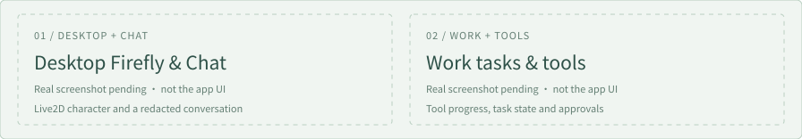

<p align="center"><a href="./README.md">简体中文</a> · <b>English</b></p>

<p align="center"><b>Talk with Firefly. Turn ideas into actions you can build on.</b></p>

<p align="center">
  
  
  
  
  
  
  
</p>

<p align="center">A Windows Live2D desktop companion and AI workbench featuring Firefly from Honkai: Star Rail.</p>

<p align="center">
  <a href="#quick-start">Quick start</a> · <a href="#features">Features</a> · <a href="#security-and-privacy">Security and privacy</a> · <a href="#interface-preview">Interface preview</a> · <a href="#status-and-limitations">Status and limitations</a><br>
  <a href="https://github.com/Firefly-0423/Firefly-Agent">Repository</a> · <a href="https://github.com/Firefly-0423/Firefly-Agent/issues">Issues</a>
</p>

## At a glance

Firefly_Agent puts a desktop character who chats with you and an agent workbench that actually gets things done into one window. Talk with Firefly, or hand her document work, code changes, research, and reminders, and see every step she takes and every approval she needs from you.

- **A persona, with limits.** Conversation follows Firefly's canon and way of speaking; tools, permissions, approvals, and the truthfulness of results are never loosened by the character's tone.
- **Three modes, one entry point.** Chat for companionship, Work for tasks, Code for code, each with its own prompts and toolset.
- **Memory stays local.** Personal memory and history retrieval live on your machine in SQLite; whether anything leaves it depends on the model and tools you choose.
- **Restrained by default.** Writing files, running commands, and online actions go through permission levels and approvals; manual authorization in the browser never becomes Agent authorization.
- **Extensible.** Skills, local plugins, MCP servers, and external channels are all optional.

| Chat · Desktop companion | Work · Move tasks forward | Code · Code workspace |
| --- | --- | --- |
| Character conversations, streamed replies, and history; Live2D expressions and idle motion. | Files, documents, and knowledge; use tools and Skills and collaborate with specialist Agents. | Use Git, LSP, AST, file, and command tools in a linked workspace. |

## Quick start

You need Windows, Node.js 24, and npm 10 or later; local packaging also needs Rust (MSVC toolchain) and C++ build tools. The source repository does not include a ready-to-use model, speech resources, or account credentials.

```powershell
git clone https://github.com/Firefly-0423/Firefly-Agent.git
cd Firefly-Agent
npm ci
```

Start with an isolated development directory inside the repository, so your real data is untouched:

```powershell
$fireflyDevRoot = Join-Path (Get-Location).Path "output\development-profile"
New-Item -ItemType Directory -Force -Path $fireflyDevRoot | Out-Null
$env:FIREFLY_RUNTIME_PROFILE = "development"
$env:FIREFLY_ISOLATION_ROOT = (Resolve-Path -LiteralPath $fireflyDevRoot).Path
npm run dev
```

The isolation root must be an existing absolute directory that is neither equal to nor a parent or child of the production appData directory; otherwise startup is refused. To run built output instead, execute `npm run build` and `npm start` in the same session where those variables are set.

After the first launch:

1. Create a **model profile** in Settings: the protocol, endpoint, model, and your own credentials that the service supports. OpenRouter has a ready preset.
2. Pick **Chat / Work / Code**. Work and Code bind a workspace per task, and specialist Agents use a saved model profile; if none is configured, you get a clear error instead of a silent failure.
3. Turn on tools, Skills, plugins, or MCP as needed. File writes, commands, and external actions go through approval and can be cancelled at any time.

Everyday checks and packaging entry points are in [package.json](./package.json): `npm run check:renderer`, `npm test`, `npm run check:plugin-sdk`, `npm run validate:skills`, `npm run package:win:dir`. See [scripts/README.md](./scripts/README.md) for what each script does.

## Features

### Desktop companion and Chat

- Live2D Firefly: double-click expressions, dragging, idle motion, and a working expression while tools run.
- Character conversations, streamed replies, and history; temporary chats stay out of history.
- The persona comes from layered prompts and worldbook entries (background, story, voice, and canon-line examples) that are triggered by topic rather than injected every turn.
- Optional **proactive chat**: speaks up with restraint based on time of day, quiet time, and unanswered messages, and stops if you do not reply; adjustable in chat preferences.
- Desktop voice input (ASR) can be off, Mossland, or Alibaba Cloud; after you stop recording, the transcript only fills the input box and is never sent automatically.

### Work: move tasks forward

- Process files, documents, and knowledge, use built-in tools and Skills, and hand work to specialist Agents; tool execution, approvals, and cancellation are all visible.
- Built-in file read/write and patch tools, Word / Excel / PDF document tools, web search and page-text retrieval, file downloads, scheduled tasks, and a calendar.
- Finished tasks export to Markdown; "task finished" and "file fully read" are reported separately, so a partial read is never presented as a complete one.
- **Knowledge workspace**: link an existing Obsidian Vault or study folder for learning, quizzes, notes, and progress. Progress is maintained only for a Vault that already has `learn/progress.md`; ordinary tasks never create learning folders on their own.

### Code: code workspace

- Read and change code in a linked workspace with Git, LSP, structural search and rewrite (ast-grep), and file and command tools.
- Commands run through a controlled shell tool with timeouts and process-tree cleanup; language servers need the matching language environment on your machine.
- The right-hand panel opens files, diff review, the browser, and tasks, and panels can be dragged and docked.

### Memory and knowledge

- The default memory chain has three layers: current context (S), fact memory (M), and history retrieval (H). SQLite holds the current memory core.
- When history has no trustworthy snapshot, the app reports insufficient coverage instead of claiming nothing exists.
- Character and document knowledge RAG (including BGE-M3) is configured separately and does not stand in for default personal memory or history retrieval.

### Web, extensions, and channels

- **Browser workspace**: manual browsing and Agent actions are strictly separate; an Agent may use only the domains and actions Main has approved and cannot authorize itself. Downloads, cookies, and site data each have their own restricted entry.
- **Skills**: 50 third-party and adapted Skills and 4 project Skills are bundled and verified, enabled per mode with user overrides.
- **Plugins**: a local plugin host, isolated panels, a plugin SDK, and examples ([packages/plugin-sdk](./packages/plugin-sdk), [examples](./examples)).
- **MCP**: configure external MCP servers (stdio, SSE, HTTP).
- **Channels**: adapters for QQ, QQ Bot, WeChat, and Feishu are kept and need your own credentials; the Firefly phone app is only a reserved entry for now.
- **Music**: reads the QQ Music playback session on Windows.

### Models

- An OpenRouter preset and a Chat Completions entry point are available. Image input is decided in layers: your declaration, then the provider's model list, then the built-in catalog; when it cannot be confirmed, the model is treated as text-only.
- Results depend on the selected model and service; reasoning replay and streaming-error compatibility still need to be validated against each upstream.

## Security and privacy

- **Permission levels and approvals**: files and commands run under read-only, project-read-only, restricted, or full levels; writes, commands, and external actions follow approval and can be cancelled. Characters, Skills, and portraits never widen tool permissions.
- **Command execution**: the shell tool has total and idle timeouts and cleans up the whole process tree on finish or cancel.
- **Browser**: manual authorization does not grant Agents control; private-network targets have a separate restriction.
- **Local data**: settings, credentials, history, and user Skills are not part of Git or the installer. The memory database key is protected with Windows DPAPI, and channel credentials use the system's encrypted storage.
- **Data location**: production data lives in `%APPDATA%\Firefly` by default and development instances use the isolation directory; quit the app and back up before touching it by hand.
- **External services**: depending on the model and the action, conversations, materials, tool results, and recordings may be sent to external services; use only services you trust.

## Interface preview

<picture>
    <source media="(prefers-color-scheme: dark)" srcset="./readme-assets/screenshots-pending-dark.en.svg">
    <source media="(prefers-color-scheme: light)" srcset="./readme-assets/screenshots-pending-light.en.svg">
    
  </picture>

**Real screenshots are pending.** The character at the top is a render of the existing Live2D model and cannot stand in for real product screenshots.

## Tech stack

| Layer | Technology |
| --- | --- |
| Runtime | Node.js 24 + Electron 43 |
| Language and build | TypeScript, Vite 7, electron-builder |
| UI | React 19, Ant Design 6 / Ant Design X, Tailwind CSS 4, react-resizable-panels |
| Live2D | PixiJS 7 + pixi-live2d-display |
| Agent | In-house Harness main loop, AG-UI event protocol, native tool calling |
| Tools and code | In-house tool dispatch and approvals, LSP client, `@ast-grep/napi`, `simple-git`, MCP SDK |
| Memory and retrieval | SQLite (`node:sqlite`), embeddings, BM25, reranker |
| Browser | Electron-based browser workspace |
| Native helpers | Rust: screenshot, history-reading and workspace handle helpers |
| Rendering | Streamdown, Shiki, KaTeX |
| Testing | Vitest |

## Project layout

The app starts from `src/main/index.ts`, compiled to `dist/main/main/index.js`. The preload layer provides controlled IPC; React and Live2D handle windows and the desktop presentation.

| Path | Responsibility |
| --- | --- |
| `src/main/` | Main-process services: orchestration, memory, browser, channels, scheduling, proactive chat, permissions, settings |
| `src/main/orchestrator/` | Agent orchestration, tool execution, specialist Agents, permission integration |
| `src/main/windows/`, `src/main/plugin-host/` | Windows, tray and app icons; Main-process plugin wiring and runtime |
| `src/main/chat/`, `src/main/chats/`, `src/main/stickers/` | Chat requests and time context; conversation storage and dispatch; stickers |
| `src/preload/`, `src/renderer/` | Controlled bridge, React UI, and Live2D |
| `src/plugins/`, `packages/plugin-sdk/`, `examples/` | Plugin host, local SDK, schema, and examples |
| `src/shared/` | IPC, data and event contracts, safe ZIP extraction |
| `skills/`, `vendor/firefly-skills/` | Project and inherited Skills with provenance, licenses, and validation |
| `prompts/`, `assets/` | Layered character prompts, worldbook, and product assets |
| `native/` | Rust native helpers: screenshots, history reading, workspace handle access |
| `scripts/`, `electron-builder.yml` | Build, packaging, verification scripts, and packaging config |
| `docs/` | Design, validation, and review records |
| `assets/`, `src/renderer/public/`, `readme-assets/` | App icons and installer assets; renderer static files; README images and their sources |
| `build/`, `resources/` | Installer script; packaging inputs prepared before a build (some generated or downloaded) |
| `dist/`, `release/`, `output/` | Build output, packages, local reports and isolated development data (none of it in Git) |

## Status and limitations

The project is under active development. Feature entry points, automated checks, and real-environment validation are described separately; historical test counts are not cited as a conclusion about the current version.

- **You provide**: the model service, knowledge embedding resources, ASR, QQ Music, office applications, language servers, and channel credentials; an entry point existing does not mean the service behind it is ready.
- **Still to validate end to end**: real models, deep GUI flows, real user environments, microphone and ASR, external office workflows, installer upgrades, and cross-platform compatibility.
- **Platform**: Windows is the primary development and validation platform.
- **UI language**: Settings is currently Chinese only; the chat window language option takes effect after a restart.
- **Release status**: auto-update is off; there is no commitment to a public installer, an online plugin marketplace of this project, or a published SDK package.
- **Character assets**: the authorization material needed for public redistribution still has to be archived; see the license notes below.

## Contributing

Read [AGENTS.md](./AGENTS.md) and [DEVELOPMENT.md](./DEVELOPMENT.md) before changing code, run the checks that match your change, and state what you did not cover. Do not attach keys, private conversations, or user data to issues or pull requests.

## License and character assets

Source code is licensed by Firefly-0423 under the [MIT License](./LICENSE). Third-party dependencies, Skills, models, images, and character IP each remain subject to their own licenses or permissions.

The project owner confirms that authorization was obtained from the original author of the Firefly model; the repository does not yet archive a verifiable author credit, the original authorization text, the files it covers, or the redistribution scope, so the specific scope of public redistribution cannot be confirmed from it. Model authorization does not automatically cover avatars, task portraits, icons, textures, or derived render assets, and the MIT source license does not grant redistribution rights to them. See [MODEL_LICENSE.md](./MODEL_LICENSE.md) and [THIRD_PARTY_NOTICES.md](./THIRD_PARTY_NOTICES.md).

Firefly and Honkai: Star Rail characters and intellectual property belong to HoYoverse / miHoYo and the respective rights holders; this is an unofficial project.

**Non-commercial use**: anything that contains the Firefly character, the Live2D model or the character artwork may not be used commercially (selling it, paid communities, advertising revenue, bundled sales). The MIT license covers the source code only.

The badges at the top are generated by [Shields.io](https://shields.io) when the page loads, with icons from Simple Icons (CC0); the repository stores none of those brand icons. They only describe the stack and platform and do not mean tested-and-passing or official affiliation. See the [icon sources](./readme-assets/ICON_SOURCES.md).
