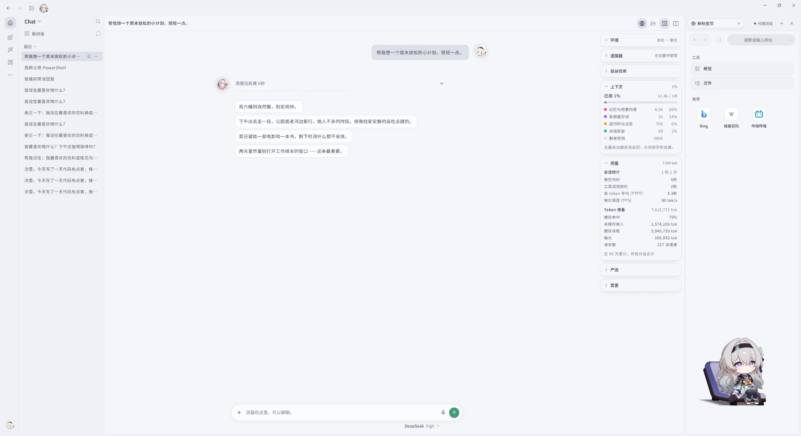
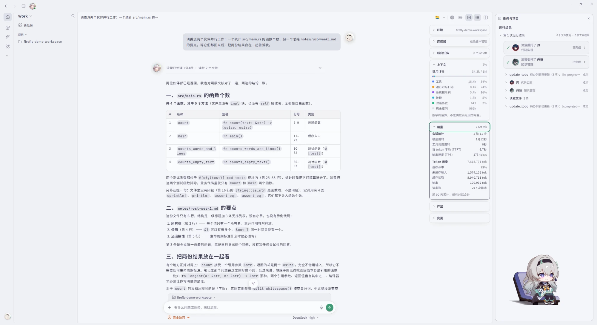
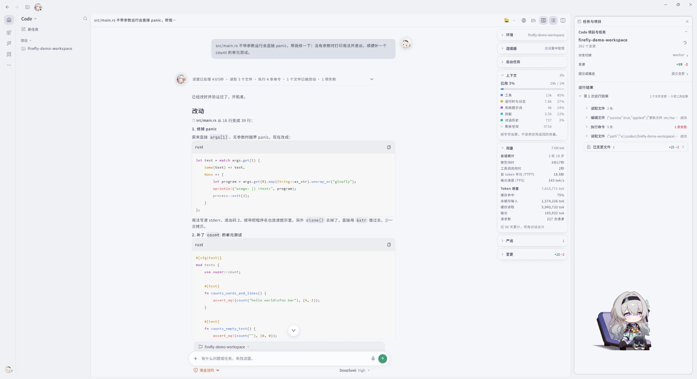
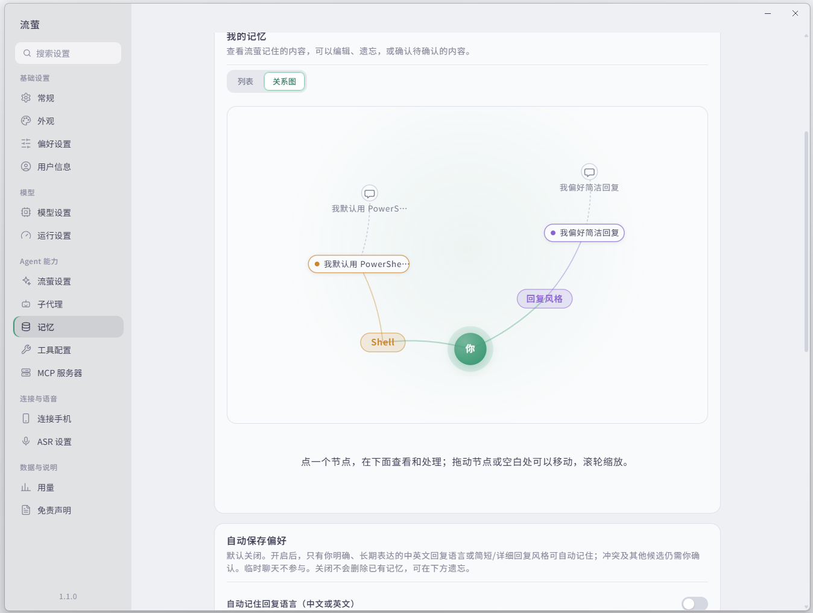

<p align="center"><a href="./README.md">简体中文</a> · <b>English</b></p>

<p align="center">
  <picture>
    <source media="(prefers-color-scheme: dark)" srcset="./readme-assets/firefly-banner-dark.en.gif">
    
  </picture>
</p>

<p align="center">
  <a href="https://github.com/Firefly-0423/Firefly-Agent"></a>
  <a href="https://gitcode.com/hotaru_wu/Firefly-Agent"></a>
</p>

<h3 align="center">Someone lives on your desktop. She keeps you company, and she helps you finish the work.</h3>

Picture this: you open your PC, and in the corner of the screen Firefly is already sitting there.

You can skip the work entirely and just talk about your day. What you tell her about your habits stays on your own machine, so you never have to repeat it. When there is real work, a document to tidy, a bug to fix, something to look up, she switches into work mode and gets on with it.

Before she acts, she asks. Which file she wants to change, which command she wants to run: it all goes in front of you first, and you can stop her at any point.

This is an unofficial fan project. What we want to build is a companion you would actually keep on your desktop, and one you can trust.

<p align="center">
  <b><a href="https://github.com/Firefly-0423/Firefly-Agent/releases/latest">Download</a></b>
  &nbsp;·&nbsp;
  <b><a href="./docs/user-guide/index.md">User guide</a></b> (in Chinese)
</p>

## Meet her

<p align="center">
  <br>
  <b>When you want to unwind, just talk. She gives you the few lines you wanted and does not talk over you.</b>
</p>

<p align="center">
  <br>
  <b>When there is a lot to do, she splits it among her partners, checks what comes back, and gives you just the conclusion.</b>
</p>

<p align="center">
  <br>
  <b>Code edits and commands are laid out in the open: which lines changed, which command failed, all at a glance.</b>
</p>

<p align="center">
  <br>
  <b>You can see what she remembers. Review it, edit it, or ask her to forget.</b>
</p>

<!-- More screenshots (Live2D desktop pet, plugin windows, approval prompts) will be added after the 1.2.0 real-machine test. -->

## What she can do

**Three modes**
- Chat is for talking; real work goes to Work.
- Work handles documents and everyday tasks. Code reads code, edits it and runs commands.

**Like a small team**
- On a complex task, Firefly hands parts of it to 12 partners working in parallel, then reviews everything when they return.

**Lives on your desktop**
- A Live2D figure stays on your desktop, changes expression as work progresses, and can check in on a rhythm you set.

**Kept on your own machine**
- Conversations and long-term memory stay local; model keys and credentials are encrypted with the system's own protection.

**Ask first, then act**
- File access has three levels: read-only, ask for approval, and full access. Risky actions go through an approval prompt first, and you can cancel a run at any time.

**Online, and extensible**
- A built-in browser that you can use yourself or authorize Firefly to operate.
- Connect several compatible model services and switch between them whenever you like.
- Local plugins, Skills, MCP tools and scheduled reminders.

## Download and install

1. Download the latest installer from [GitHub Releases](https://github.com/Firefly-0423/Firefly-Agent/releases/latest). You need Windows 10 or 11 (64-bit).
2. Install and open it, go to Settings, and add at least one model profile with your own model endpoint and key.
3. Go back to the chat page and say hello.

Version 1.2.0 keeps conversations, settings and logs in a separate `%APPDATA%\Firefly-1.2.0` folder. It never reads, changes or migrates data from 1.1.x. If you only want a look at the interface first, try the [online demo](https://hotarufirefly.online).

Please read the [disclaimer](./docs/disclaimer.en.md) before use. Notes on external chat channels and the data folder are in the [user guide](./docs/user-guide/index.md) (in Chinese).

## What's new in 1.2.0 and known limitations

**What's new**
- A new dark theme: near-black surfaces with an emerald accent, with consistent depth across chat, settings and reminder toasts.
- A new plugin system: plugins run in separate processes, with local import, a capability and trust prompt before enabling, per-permission revocation, model rate limits and isolated plugin windows. Legacy 0.x plugins are no longer supported.
- Scheduled tasks proposed by plugins are enabled only after you confirm them, with time-zone-aware schedules and a "Run now" option.
- Work and Code runs keep finishing in the background after you switch chats or refresh, you can answer approvals from the reminder toast, and you can add new instructions mid-run with "Send now".
- Permissions are simplified to three levels: read-only, ask for approval, full access.

Full release notes are on [GitHub Releases](https://github.com/Firefly-0423/Firefly-Agent/releases) and in `CHANGELOG.md` on the release branch.

**Known limitations**
- 1.2.0 has no unattended approval yet. A plugin schedule that would use the command line, write files, or control the keyboard and mouse is refused at confirmation. Tasks of that kind confirmed earlier are skipped when due and their recurring schedule is paused. Unattended approval is planned for 1.2.x.
- The desktop setup screen for external chat channels also arrives in 1.2.x.

## Plugin development

- [Plugin SDK README](./plugin-sdk/README.md): installation, the minimal plugin layout, the permission model and the local test host.
- [Plugin Development Guide](./docs/plugins/plugin-dev-guide.md): manifest fields, the API reference and complete examples.
- [Plugin Authoring Notes](./docs/plugins/plugin-authoring.md): isolation boundaries, permission tiers and catalog requirements.

Two sample plugins, weather lookup and a daily reminder, live in [plugin-sdk/examples](./plugin-sdk/examples/).

## Contributing

Running from source needs **Windows**, **Node.js 24+** and **pnpm 12.10.1**.

```powershell
pnpm install
pnpm exec install-electron
pnpm run dev
```

For environment setup, packaging and commit conventions, see the [development guide](./docs/contributing/development.md) (in Chinese) and the [development workflow](./docs/contributing/development-workflow.md). The full documentation index is the [docs directory](./docs/README.md).

## Feedback and links

- Bug reports and feature requests: [GitHub Issues](https://github.com/Firefly-0423/Firefly-Agent/issues).
- Skills: [firefly-skills](https://github.com/Firefly-0423/firefly-skills).
- Plugin catalog: [firefly-plugins](https://github.com/Firefly-0423/firefly-plugins).

Please remove API keys, private chats and local paths before sharing logs or opening an issue.

## License and credits

- This is an **unofficial, non-commercial fan project** with no affiliation to HoYoverse / miHoYo. Firefly and Honkai: Star Rail character art and intellectual property belong to HoYoverse / miHoYo and their respective rights holders. Commercial use of derivatives containing the character, the model or character artwork is prohibited.
- Source code is licensed under the [MIT License](./LICENSE).
- Third-party dependencies, bundled Skills and historical provenance notices are in [THIRD_PARTY_NOTICES.md](./THIRD_PARTY_NOTICES.md); the Live2D model permission and source are in [MODEL_LICENSE.md](./MODEL_LICENSE.md).
