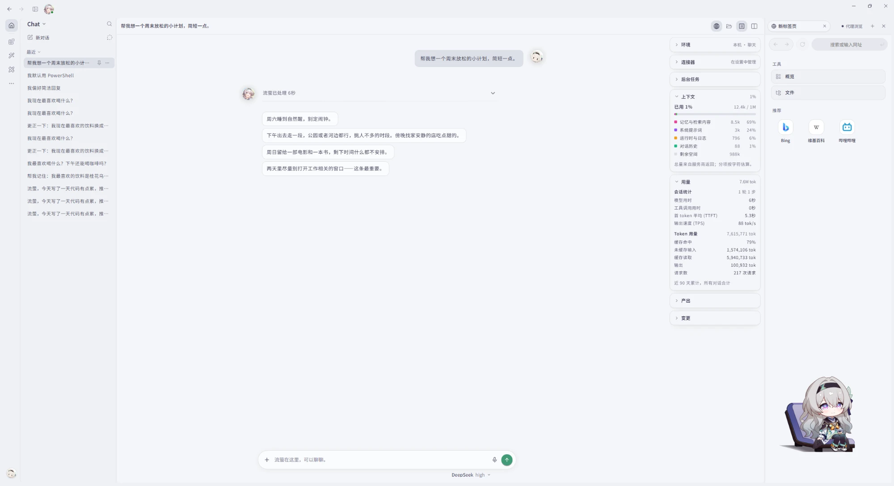
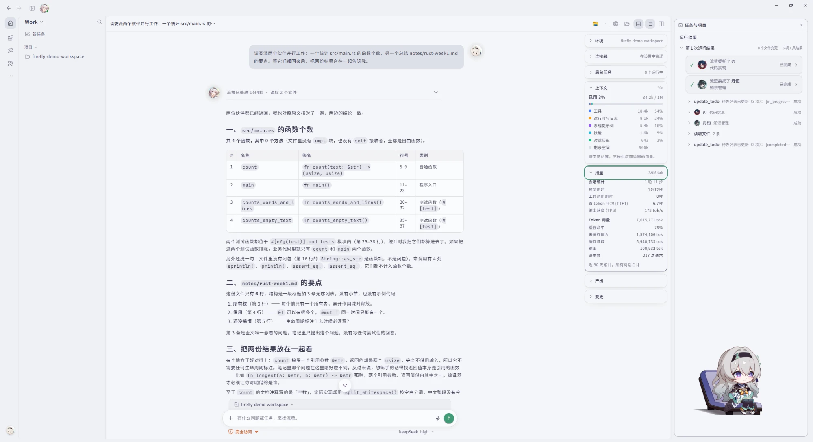
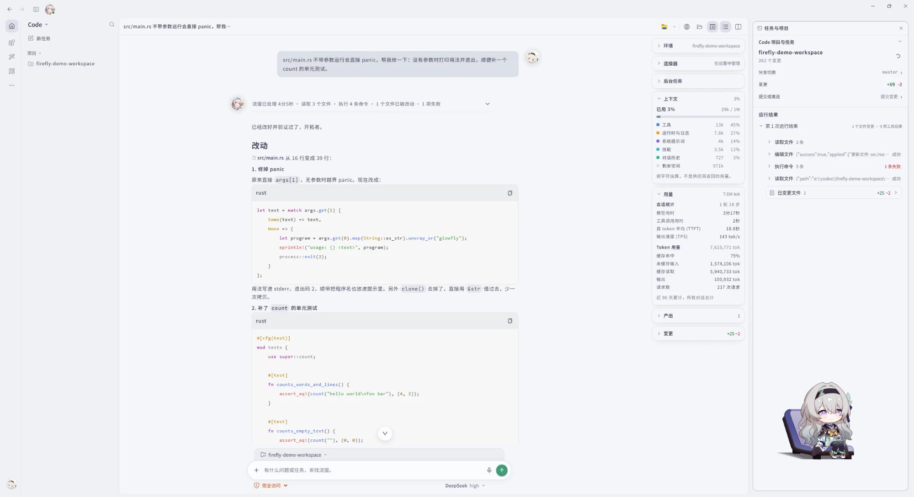
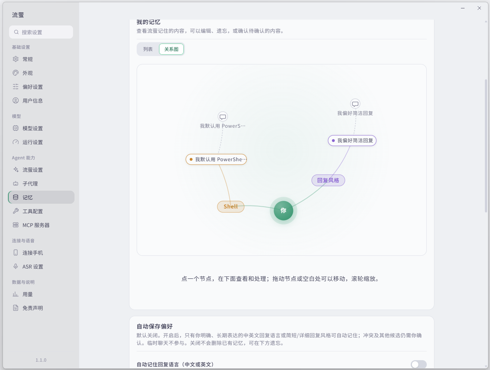

<p align="center"><a href="./README.md">简体中文</a> · <b>English</b></p>

<p align="center">
  <picture>
    <source media="(prefers-color-scheme: dark)" srcset="./readme-assets/firefly-banner-dark.en.gif">
    
  </picture>
</p>

<p align="center">
  
  
  
  
  
  
  
</p>

<p align="center">A Windows Live2D desktop companion and AI workbench featuring Firefly from Honkai: Star Rail.</p>

<p align="center">
  <a href="#-screenshots">Screenshots</a> · <a href="#-quick-start">Quick start</a> · <a href="#-features">Features</a> · <a href="#-security-and-privacy">Security</a> · <a href="#-project-structure">Structure</a> · <a href="#-status-and-limits">Status</a><br>
  <a href="https://github.com/Firefly-0423/Firefly-Agent/issues">Issues</a> · <a href="https://github.com/Firefly-0423/firefly-plugins">Plugin marketplace</a>
</p>

---

## ✨ At a glance

Firefly puts a desktop character who chats with you and an agent workbench that actually gets things done in one window. Chat with Firefly, or hand her document work, code changes, research and reminders, and see each step she takes and what she needs you to approve.

- **A persona, with boundaries**: conversations follow Firefly's canon and voice; tools, permissions, approvals and honest results never loosen because of the character's tone.
- **Three modes, one entry point**: Chat for company, Work for tasks, Code for code, each with its own prompts and tools.
- **Memory stays local**: personal memory and history search live in SQLite on your machine; whether anything leaves it depends on the models and tools you choose.
- **Restrained by default**: writing files, running commands and going online go through permission levels and approvals; approving a site in the browser never authorizes the agent.
- **Extensible**: Skills, plugins, MCP servers and external channels are all optional.

| 💬 Chat · Companion | 📋 Work · Tasks | 💻 Code · Workspace |
| --- | --- | --- |
| In-character chat, streamed replies and history; Live2D expressions and idle motions. | Files, documents and knowledge; tools and Skills, with specialist agents. | Git, LSP, AST, file and command tools inside a bound workspace. |

## 📸 Screenshots

<p align="center"><b>💬 Chat · Desktop companion</b></p>
<p align="center"></p>
<p align="center"><sub>Talking with Firefly. The built-in browser is open on the right, the overview cards show context and usage (the total comes from the provider), and the Live2D Firefly sits on the desktop.</sub></p>

<p align="center"><b>📋 Work · Tasks</b></p>
<p align="center"></p>
<p align="center"><sub>Firefly splits a task between two partners working in parallel (Blade counts the functions, Dan Heng summarizes the notes), checks their answers against the sources, and combines them. Each partner's run result is on the right.</sub></p>

<p align="center"><b>💻 Code · Workspace</b></p>
<p align="center"></p>
<p align="center"><sub>Fixing a panic and adding a test in a bound project. The run folds into one summary line (files read, commands run, what changed, what failed); the branch, changes and run results are on the right.</sub></p>

<p align="center"><b>🧠 Memory graph</b></p>
<p align="center"></p>
<p align="center"><sub>Settings → Memory → Graph: you in the centre, linked to each category, each memory and the conversation it came from. Click a node to review it; drag and zoom to explore.</sub></p>

## 🚀 Quick start

You need Windows, Node.js 24 and npm 10 or later; packaging also needs Rust (MSVC toolchain) and C++ build tools. The sources ship no models, voice resources or account credentials.

```powershell
git clone https://github.com/Firefly-0423/Firefly-Agent.git
cd Firefly-Agent
npm ci
```

Start with a development profile inside the repository, so your real data is never touched:

```powershell
$fireflyDevRoot = Join-Path (Get-Location).Path "output\development-profile"
New-Item -ItemType Directory -Force -Path $fireflyDevRoot | Out-Null
$env:FIREFLY_RUNTIME_PROFILE = "development"
$env:FIREFLY_ISOLATION_ROOT = (Resolve-Path -LiteralPath $fireflyDevRoot).Path
npm run dev
```

The isolation root must be an existing absolute directory that is neither the production appData directory nor its parent or child; otherwise startup is refused. To start from a build, run `npm run build` and `npm start` in the same session with these variables set.

After the first launch:

1. Create a **model profile** in Settings: the protocol, endpoint and model your service supports, plus your own credentials. OpenRouter has a preset.
2. Pick **Chat / Work / Code**. Work and Code bind each task to a project folder; you can also create a project first with the "+" next to Projects in the sidebar.
3. Turn on tools, Skills, plugins or MCP as needed. Writing files, running commands and external actions ask for approval and can be cancelled at any time.

Common checks and packaging:

| Command | Purpose |
| --- | --- |
| `npm run check:renderer` | Type-check the interface |
| `npm test` | Run Vitest |
| `npm run validate:skills` | Validate Skill sources and licenses |
| `npm run check:plugin-sdk` | Check the plugin SDK |
| `npm run package:win:dir` | Package as an unpacked directory |

Scripts are described in [scripts/README.md](./scripts/README.md).

## 🧩 Features

### 💬 Desktop companion and Chat

- Live2D Firefly: double-click expressions, dragging, idle motions, and a working expression while tools run.
- In-character chat, streamed replies, history; temporary chats stay out of history.
- The persona comes from layered prompts and lore entries (background, story, voice, canon quotes), triggered by topic rather than sent every turn.
- Optional **proactive chat**: speaks up sparingly by time of day, silence and unanswered messages, and stops when you do not reply.
- Desktop voice input (ASR): off, Mossland or Alibaba Cloud; the transcript fills the composer and is never sent automatically.

### 📋 Work: tasks

- Works with files, documents and knowledge, calls built-in tools and Skills, and delegates to specialist agents; tool runs, approvals and cancellation are all visible.
- Built-in file read/write and patching, Word / Excel / PDF tools, web search and reading, downloads, scheduled tasks and calendar.
- A run folds to one summary line (time taken, files read, commands run). Expanded, it is one timeline: consecutive reads and searches share a row, thinking folds away when it ends, and edits, commands and failures keep their own rows.
- Finished tasks export to Markdown; "task done" and "file fully read" are shown separately.
- **Knowledge workspace**: bind an existing Obsidian vault or study folder for learning, quizzes, notes and progress.

### 💻 Code: workspace

- Read and change code in a bound workspace: Git, LSP, structural search and rewrite (ast-grep), file and command tools.
- Commands run through a controlled shell tool with timeouts and process-tree cleanup; language servers need the language installed locally.
- The right panel opens files, diff review, the browser and the task panel, and can be docked by dragging.

### 🗂️ Sidebar and composer

- **Projects**: the sidebar groups conversations by project; "+" creates a project (name it and choose its source folder), "..." organizes the sidebar and sorts chats, with pinning, sections and hidden projects.
- **Conversation menu**: rename, pin, copy the title or project path, open the project in File Explorer or a detected editor, export, delete.
- **Floating composer**: in a conversation, hover the composer to drag it anywhere in the workspace or collapse it to a round button; it reopens for a pending approval or question.
- **Session overview**: cards beside the conversation show the environment, connectors, background tasks, context, usage, outputs and changes, and can be dragged into any order. The context total comes from the usage the provider reports; the breakdown is estimated from character counts.

### 🧠 Memory and knowledge

- The default memory chain has three layers: current context (S), fact memory (M) and history search (H), stored in SQLite.
- Project details mentioned inside a project are used only there; when history lacks a trusted snapshot, Firefly reports incomplete coverage instead of guessing.
- Character and document knowledge RAG (including BGE-M3) is configured separately and is not the default personal memory.
- The **memory graph** in settings draws confirmed and pending memories by category and links them to the conversations they came from. Blank candidates are discarded instead of waiting for review.
- Subtasks delegated to specialist agents reuse the history reading of the conversation that started them instead of opening their own.

### 🔌 Web, extensions and channels

- **Browser workspace**: manual browsing and agent actions are kept apart; the agent works only within the domains and actions currently approved.
- **Skills**: 50 third-party and adapted Skills plus 4 project Skills, validated and enabled per mode.
- **Skills market**: install Skills from [firefly-skills](https://github.com/Firefly-0423/firefly-skills), openai/plugins and anthropics/skills. Only a statically reviewed version, pinned to a commit and matching its content digest, can be installed, and it starts disabled.
- **Plugins**: a local plugin host, isolated panels, the plugin SDK and examples; the online catalog comes from [firefly-plugins](https://github.com/Firefly-0423/firefly-plugins), packages are checked against their SHA-256 on install and start disabled.
- **MCP**: add a server by its local command (stdio) or its remote address (Streamable HTTP; an address ending in `/sse` uses legacy SSE).
- **Channels**: QQ, QQ Bot, WeChat and Feishu adapters, with your own credentials.
- **Music**: reads the QQ Music playback session on Windows.

### 🤖 Models

- An OpenRouter preset and a Chat Completions entry; image input is decided by user declaration, then the vendor model list, then the built-in catalog, and falls back to text when unsure.
- Results depend on the model and service you choose.

## 🔒 Security and privacy

- **Permission levels and approvals**: files and commands run at read-only, project read-only, scoped or full access; writes, commands and external actions follow approvals and can be cancelled. Personas, Skills and avatars never widen tool permissions.
- **Command execution**: the shell tool has total and idle timeouts and cleans up the whole process tree on finish or cancel.
- **Browser**: approving a site manually gives the agent no rights; private-network targets have their own limits. Under a TUN proxy in fake-ip mode (such as Mihomo), manual browsing first confirms over DoH that the real address is public; agent browsing refuses fake-ip addresses.
- **Local data**: settings, credentials, history and user Skills never enter Git or the installer. The memory database key is protected with Windows DPAPI; channel credentials use system encryption.
- **Data location**: production data lives in `%APPDATA%\Firefly` by default, development instances use an isolation root; quit the app and back up before touching it by hand.
- **External services**: depending on the model and action, conversations, documents, tool results and recordings may be sent to external services; use services you trust.

## 🛠️ Tech stack

| Layer | Technology |
| --- | --- |
| Runtime | Node.js 24 + Electron 43 |
| Language and build | TypeScript, Vite 7, electron-builder |
| Interface | React 19, Ant Design 6 / Ant Design X, Tailwind CSS 4; bundled Noto Sans SC and JetBrains Mono variable fonts; d3-force for the memory graph |
| Live2D | PixiJS 7 + pixi-live2d-display |
| Agent | Own harness loop, AG-UI event protocol, native tool calling |
| Tools and code | Tool scheduling and approvals, LSP client, `@ast-grep/napi`, `simple-git`, MCP SDK |
| Memory and retrieval | SQLite (`node:sqlite`), embeddings, BM25, reranker |
| Native helpers | Rust: screenshots, history reading, workspace handle access |
| Rendering | Streamdown, Shiki, KaTeX |
| Tests | Vitest |

## 📦 Project structure

```
src/
├── cli/                  # Command line (firefly command, development launcher)
├── main/                 # Electron main process, entry index.ts → dist/main/main/index.js
│   ├── application/      # Startup wiring, dependency injection, IPC scopes and contract scan
│   ├── startup/          # Runtime profile and data isolation, identity preflight, single instance, startup windows
│   ├── orchestrator/     # Agent core
│   │   ├── harness/      #   Harness loop: turns, compaction, retries, uncertainty
│   │   ├── tools/        #   Tool registry and built-in tools (files, documents, Git, LSP, ast-grep…)
│   │   ├── vendors/      #   Model vendor adapters (structured output, function calling)
│   │   ├── sandbox/      #   Windows command sandbox
│   │   ├── review/       #   Plan review
│   │   └── structured-output/  # Unified structured-output pipeline
│   ├── permission/       # Permission levels, risk verdicts and approval cards
│   ├── chat/ chats/      # Chat requests and the AG-UI bridge; conversation storage, dispatch and sidebar layout
│   ├── memory*/          # Memory: core store, policy, recall, history reading, sources, shadow extraction
│   ├── rag/ knowledge/   # Knowledge retrieval; Obsidian / study workspace
│   ├── browser/          # Built-in browser workspace and its authorization boundary
│   ├── code-git/ lsp/    # Git service for Code mode; language server client
│   ├── channels/         # External channels (Feishu, WeChat, QQ, QQ Bot)
│   ├── proactive/        # Proactive chat (timing, policy, delivery)
│   ├── scheduler/ tasks/ # Scheduled tasks; tasks and sub-agent sessions
│   ├── skills/           # Skill installation, review and external sources
│   ├── plugin-host/ plugin-panel/  # Plugin host and online marketplace; plugin panel protocol
│   ├── settings/ storage/ logging/ # Settings and credentials; local storage and paths; logs
│   ├── asr/ audio/ music/ screenshot/  # Voice input; player; QQ Music; screenshots
│   ├── windows/ toast/ updater/        # Windows and tray; notifications; app updates
│   └── ...               # protocols / prompts / services / stickers / social-context and more
├── plugins/              # Plugin system core (manifest validation, loading, lifecycle)
├── preload/              # Controlled IPC bridge
├── renderer/             # Renderer process
│   ├── react/            #   React interface: chat, sidebar, settings, components and styles
│   ├── live2d/           #   Live2D rendering
│   └── public/           #   Static assets (avatars, stickers, Cubism Core)
└── shared/               # Contracts and helpers shared by main and renderer

native/                   # Rust native helpers: screenshots, history reading, workspace handle access
plugin-sdk/               # Plugin SDK sources
examples/                 # Plugin examples (text-stats, json-tools, weather-tool and more)
skills/                   # Project Skills
vendor/firefly-skills/    # Third-party and adapted Skills, with sources and licenses
prompts/                  # Layered persona prompts and lore
models/                   # Local AI models (placed by you, see MODEL_LICENSE.md)
scripts/                  # Build, packaging, verification and evaluation scripts
docs/                     # Design, verification and review records
assets/ build/ resources/ # App icons; installer scripts; resources prepared before packaging
```

> `dist/`, `release/` and `output/` hold build output, packages and local reports, and are not in Git. See [MODEL_LICENSE.md](./MODEL_LICENSE.md) for the Live2D model.

## 📌 Status and limits

Firefly is under active development; feature entry points, automated checks and real-environment acceptance are reported separately.

- **Bring your own**: model services, knowledge vectors, ASR, QQ Music, office programs, language servers and channel credentials; an entry point does not mean the service is ready.
- **Still needs full acceptance**: end-to-end runs with real models, deep GUI testing, microphone and ASR, external office workflows, installer upgrades.
- **Platform**: Windows is the main development and acceptance platform.
- **Interface language**: Settings is Chinese-only for now; the chat window language applies after a restart.
- **Releases**: auto-update stays off and no public installer has been published yet.

## 🤝 Contributing

Read [AGENTS.md](./AGENTS.md) and [DEVELOPMENT.md](./DEVELOPMENT.md) first, run the checks that match your change, and say what was not covered. Plugin submissions go to [firefly-plugins](https://github.com/Firefly-0423/firefly-plugins). Never attach keys, private conversations or user data to issues or PRs.

## 📄 License and character assets

The source code is licensed by Firefly-0423 under the [MIT License](./LICENSE); third-party dependencies, Skills, models, images and character IP follow their own licenses or permissions, see [THIRD_PARTY_NOTICES.md](./THIRD_PARTY_NOTICES.md).

The project owner has permission from the original author of the Firefly Live2D model; see [MODEL_LICENSE.md](./MODEL_LICENSE.md). That permission does not automatically cover avatars, icons, stickers or derived renders, and the MIT license of the source code grants no redistribution rights for them.

Firefly and Honkai: Star Rail characters and intellectual property belong to HoYoverse / miHoYo and the respective rights holders. This is an unofficial, non-commercial fan project; derivatives containing the Firefly character, the Live2D model or character art may not be used commercially.

The badges are generated by [Shields.io](https://shields.io) with icons from Simple Icons (CC0); see the [icon notes](./readme-assets/ICON_SOURCES.md).
