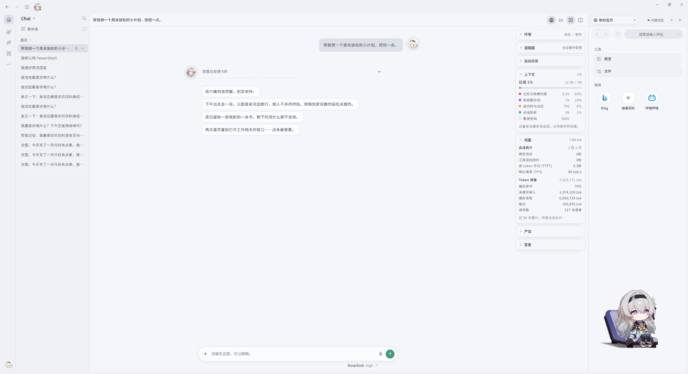
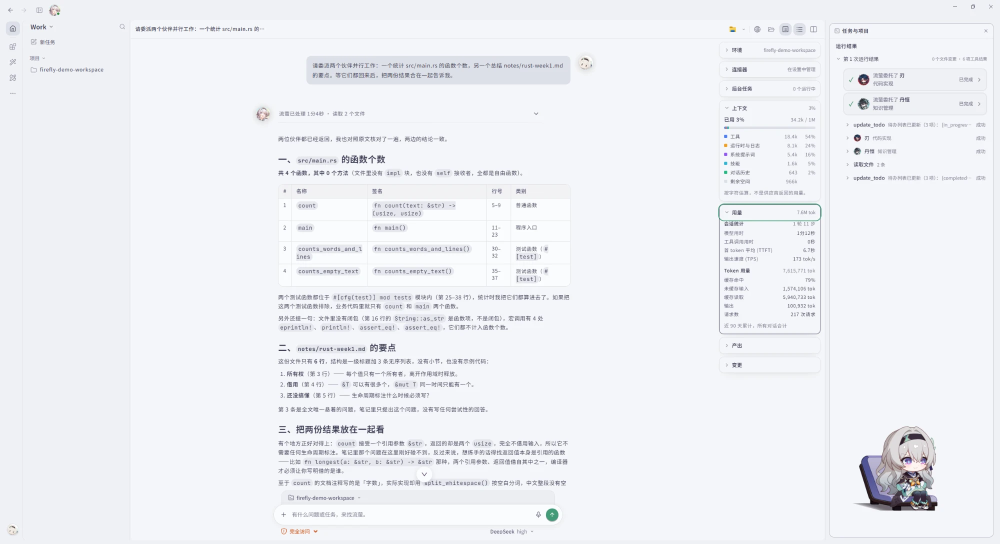
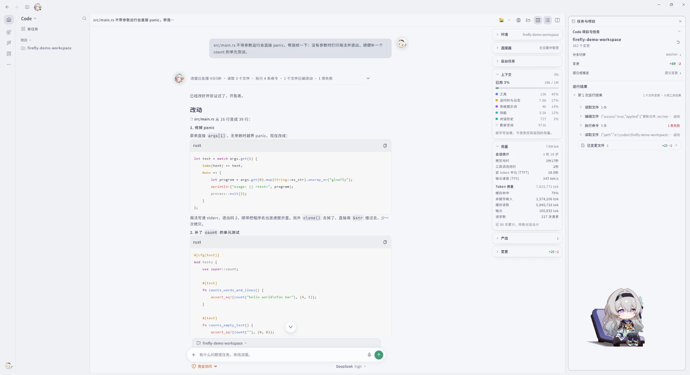
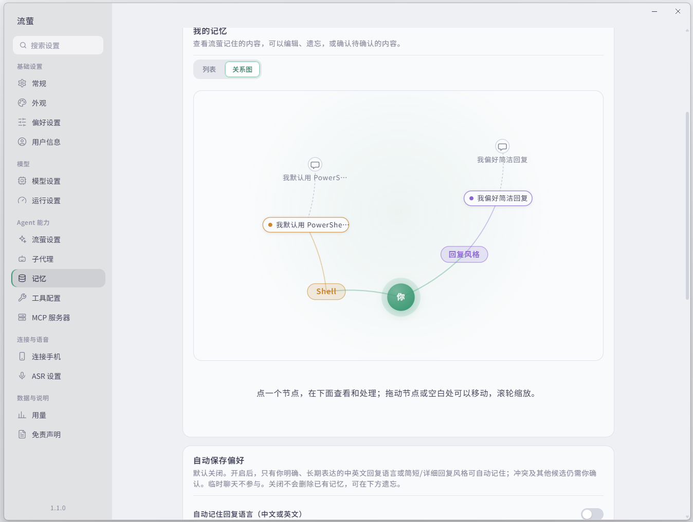

<p align="center"><b>简体中文</b> · <a href="./README.en.md">English</a></p>

<p align="center">
  <picture>
    <source media="(prefers-color-scheme: dark)" srcset="./readme-assets/firefly-banner-dark.gif">
    
  </picture>
</p>

<p align="center">
  <a href="https://github.com/Firefly-0423/Firefly-Agent"></a>
  <a href="https://gitcode.com/hotaru_wu/Firefly-Agent"></a>
</p>

<h3 align="center">有个人住在你的桌面上，陪你说话，也帮你把事做完。</h3>

想象一下：你打开电脑，桌面一角，流萤已经坐在那里了。

你可以什么正事都不谈，聊聊今天过得怎么样；你说过的偏好，她会记在你自己的电脑里，下次不用再讲一遍。等你真有事要办，整理文档、改一段代码、查点资料，她就切到工作的样子，认真帮你做。

她动手之前会先问你。要改哪个文件、要运行什么命令，都先摆出来等你点头，你随时可以叫停。

这是一个非官方的同人项目。我们想做的，是一个你愿意留在桌面上的、可以信任的伙伴。

<p align="center">
  <b><a href="https://github.com/Firefly-0423/Firefly-Agent/releases/latest">下载</a></b>
  &nbsp;·&nbsp;
  <b><a href="./docs/user-guide/index.md">上手指南</a></b>
</p>

## 看看她

<p align="center">
  <br>
  <b>想放松的时候，就聊聊天：她只回你想要的那几句，不抢话。</b>
</p>

<p align="center">
  <br>
  <b>事情一多，她会分给伙伴一起做，回来再统一核对，最后只把结论告诉你。</b>
</p>

<p align="center">
  <br>
  <b>改代码、跑命令都摊开给你看：改了哪几行、哪条命令失败了，一目了然。</b>
</p>

<p align="center">
  <br>
  <b>她记住了什么，你看得见：可以查看、编辑，也可以让她忘掉。</b>
</p>

<!-- 1.2.0 真机测试完成后，再补充 Live2D 桌宠、插件窗口和审批提示的截图。 -->

## 她能做什么

**三种模式**
- Chat 用来陪你聊天；真正要办的事，交给 Work。
- Work 处理文档和日常任务，Code 看代码、改代码、跑命令。

**像一个小团队**
- 遇到复杂任务，流萤把合适的部分分给 12 位伙伴并行处理，等大家回来再统一核对。

**住在桌面上**
- Live2D 形象常驻桌面，会随着工作进度换表情，也能按你设的节奏主动搭话。

**记在你自己的电脑里**
- 聊天记录和长期记忆都留在本地；模型密钥与凭据由系统的安全机制加密保管。

**先问，再动手**
- 文件访问分“只读 / 请求审批 / 完全访问”三档，高风险操作先弹出审批，运行中也能随时取消。

**能上网，也能被扩展**
- 内置浏览器既能你自己用，也能授权流萤代为操作。
- 可以接入多个兼容的模型服务，并随时切换。
- 支持本地插件、Skills、MCP 工具和定时提醒。

## 下载与安装

1. 到 [GitHub Releases](https://github.com/Firefly-0423/Firefly-Agent/releases/latest) 下载最新安装程序。系统需要 Windows 10 / 11（64 位）。
2. 安装并打开，进入设置页，添加至少一个模型档案，填入你自己的模型服务地址和密钥。
3. 回到聊天页，和她打个招呼。

1.2.0 把对话、设置和日志放在独立的 `%APPDATA%\Firefly-1.2.0` 目录，不会读取、修改或迁移 1.1.x 的旧数据。想先看看界面，可以访问[在线体验](https://hotarufirefly.online)。

使用前请先读[免责声明](./docs/disclaimer.zh-CN.md)；外部聊天渠道和数据目录的说明在[用户指南](./docs/user-guide/index.md)。

## 1.2.0 新变化与已知限制

**新变化**
- 全新深色主题：近黑背景配翡翠绿强调色，聊天页、设置页和提示窗口的明暗层次统一。
- 全新插件系统：插件在独立进程里运行，支持本地导入、启用前确认能力与信任、逐项撤权、模型限频和隔离的插件窗口。0.x 旧插件不再兼容。
- 插件的定时任务要经你确认才会启用，支持带时区的定时表达式和“立即运行”。
- Work 与 Code 任务切换会话或刷新后仍会在后台完成，可以直接在提醒小窗里处理审批，运行途中还能“立即补充”新要求。
- 权限收口为“只读 / 请求审批 / 完全访问”三档。

完整变更见 [GitHub Releases](https://github.com/Firefly-0423/Firefly-Agent/releases) 或发布分支上的 `CHANGELOG.md`。

**已知限制**
- 1.2.0 暂不支持无人值守审批：插件定时任务如果会用到命令行、写文件或控制键鼠，在确认时会被直接拒绝；之前已确认的这类任务，到点会跳过并暂停周期计划。无人值守审批计划在 1.2.x 补齐。
- 外部聊天渠道的桌面配置界面也要等到 1.2.x。

## 插件开发

- [插件 SDK 说明](./plugin-sdk/README.md)：安装方式、最小插件结构、权限模型和本地测试宿主。
- [插件开发指南](./docs/plugins/plugin-dev-guide.md)：清单字段、接口说明和完整示例。
- [插件作者须知](./docs/plugins/plugin-authoring.md)：隔离边界、权限分级和上架要求。

[plugin-sdk/examples](./plugin-sdk/examples/) 里有天气查询和每日提醒两个示例插件。

## 参与开发

从源码运行需要 **Windows**、**Node.js 24+** 和 **pnpm 12.10.1**。

```powershell
pnpm install
pnpm exec install-electron
pnpm run dev
```

更多环境准备、打包命令和提交规范见[开发说明](./docs/contributing/development.md)与[协作流程](./docs/contributing/development-workflow.md)；全部文档的索引在[文档目录](./docs/README.md)。

## 反馈与联系

- 使用问题与功能建议：[GitHub Issues](https://github.com/Firefly-0423/Firefly-Agent/issues)。
- Skills 投稿与维护：[firefly-skills](https://github.com/Firefly-0423/firefly-skills)。
- 插件目录与投稿：[firefly-plugins](https://github.com/Firefly-0423/firefly-plugins)。

提交反馈前，请先去掉个人密钥、对话原文和本机路径。

## 许可证与致谢

- 本项目是**非官方、非商业的同人作品**，与 HoYoverse / 米哈游没有任何官方关联。流萤及《崩坏：星穹铁道》的角色形象与知识产权归 HoYoverse / 米哈游及相应权利人所有；含角色形象或模型的衍生内容禁止商业使用。
- 桌面上的 Live2D 小人是 Steam 创意工坊的「Firefly 流萤前瞻小人桌宠」，作者**是依七哒**，已授权 Firefly 使用，谢谢她。该授权不等于开源许可，详见 [MODEL_LICENSE.md](./MODEL_LICENSE.md)。
- 源码采用 [MIT 许可证](./LICENSE) 开源。
- 第三方依赖、内置 Skills 和历史组件声明见 [THIRD_PARTY_NOTICES.md](./THIRD_PARTY_NOTICES.md)。
