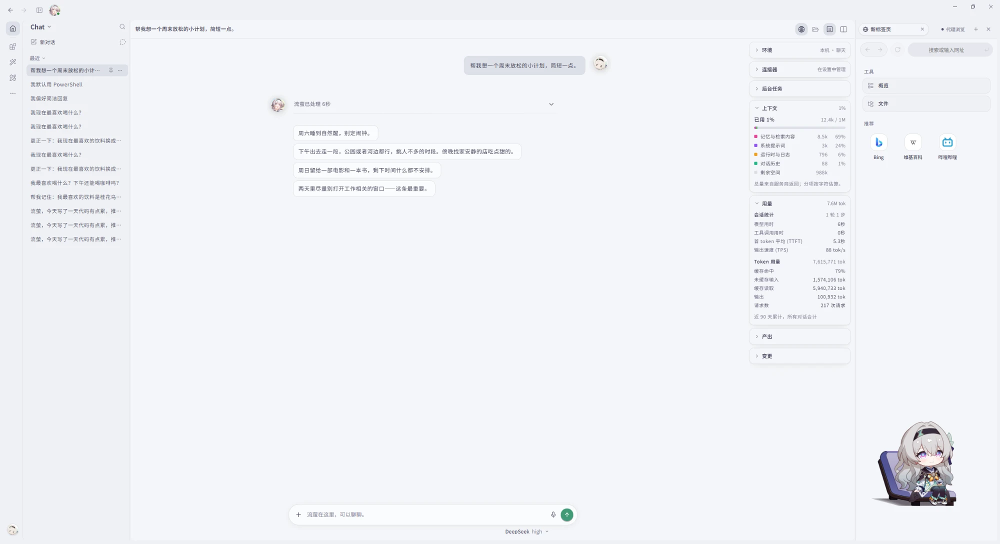
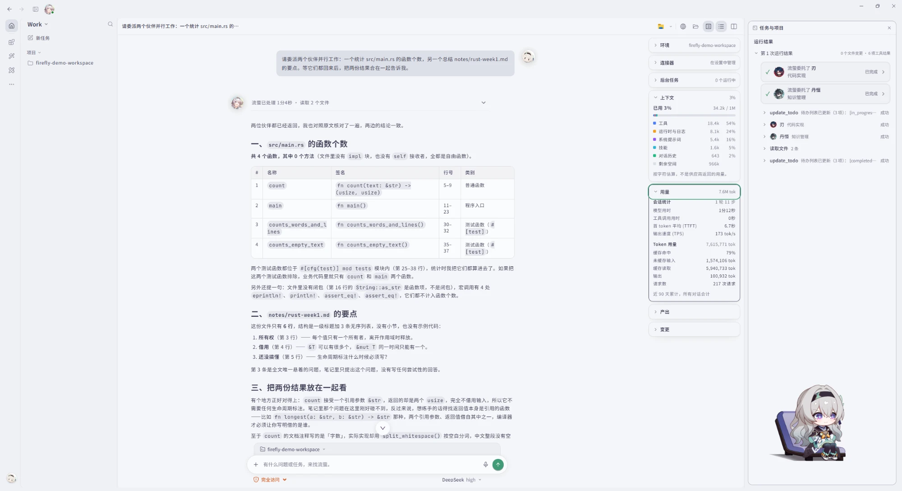
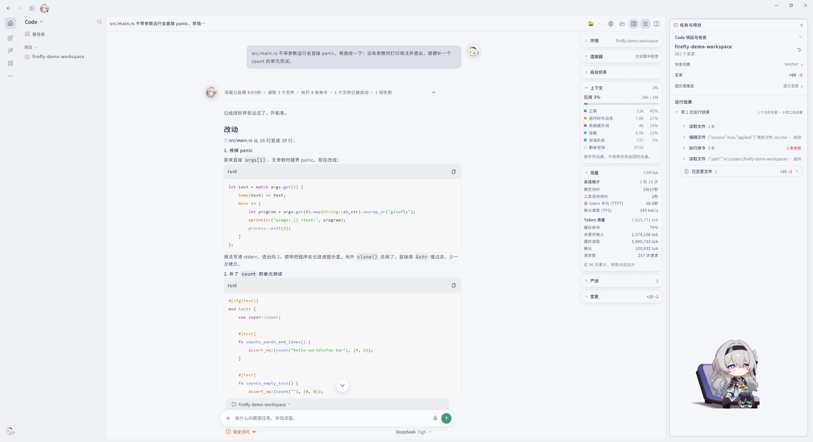
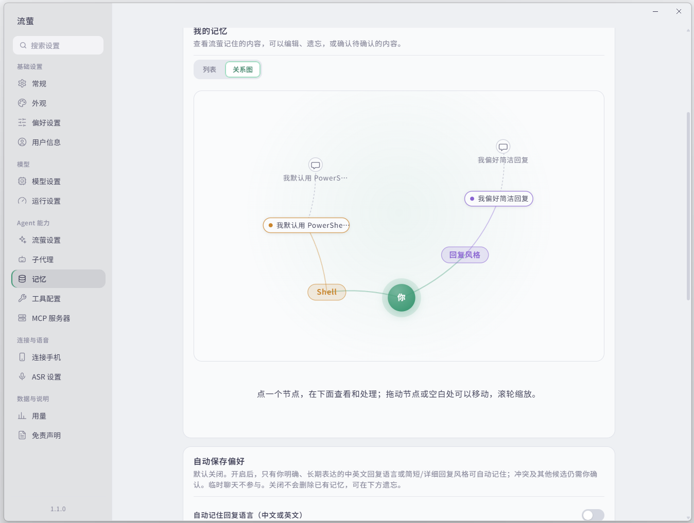
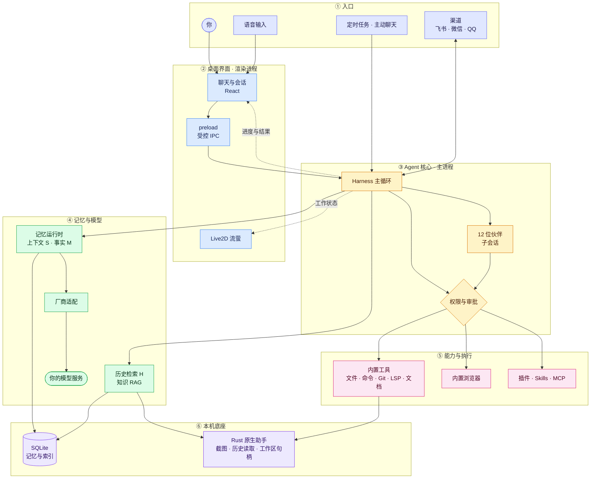

<p align="center"><b>简体中文</b> · <a href="./README.en.md">English</a></p>

<p align="center">
  <picture>
    <source media="(prefers-color-scheme: dark)" srcset="./readme-assets/firefly-banner-dark.gif">
    
  </picture>
</p>

<p align="center">
  <a href="https://github.com/Firefly-0423/Firefly-Agent/releases/latest"></a>
  
  
  <a href="https://hotarufirefly.online"></a>
</p>

<h3 align="center">陪你聊天，也帮你做事</h3>

<p align="center">以《崩坏：星穹铁道》流萤为角色的 Windows Live2D 桌面伙伴。<br>她陪你聊天，也能读写文件、改代码、跑命令，还会带上 12 位伙伴一起分工；每一步做了什么、哪里需要你批准，都看得见。</p>

<p align="center">
  <a href="https://github.com/Firefly-0423/Firefly-Agent/releases/latest"><b>下载 Windows 版</b></a> · <a href="https://hotarufirefly.online">官网与在线演示</a> · <a href="#-功能">功能</a> · <a href="#-安全与隐私">安全与隐私</a> · <a href="#-从源码运行">从源码运行</a> · <a href="https://github.com/Firefly-0423/Firefly-Agent/issues">问题反馈</a>
</p>

---

## ✨ 速览

- **有人设，也有边界**：对话遵循流萤的原作设定与说话方式；工具、权限、审批和结果真实性不会因为角色语气而放宽。
- **三种模式，一个窗口**：Chat 陪你聊天，Work 推进任务，Code 改代码，各有自己的提示词与工具。
- **流萤带着 12 位伙伴**：Work 和 Code 里，流萤把任务拆给擅长的伙伴并行处理，回来后核对、汇总；每位伙伴可以单独指定模型。
- **记忆在本机**：个人记忆与历史检索保存在本机 SQLite，记忆数据库的密钥由 Windows DPAPI 保护。
- **动手之前先问你**：写文件、执行命令、联网操作都按权限等级运行，需要你批准，也可以随时取消。
- **可扩展**：Skills 市场、插件市场、插件 SDK、MCP 服务和外部渠道都按需开启。

## 📸 界面预览

<p align="center"><b>💬 Chat · 桌面陪伴</b></p>
<p align="center"></p>
<p align="center"><sub>和流萤聊天。右侧打开了内置浏览器，概览卡片显示上下文与用量（总量来自服务商返回），Live2D 流萤常驻桌面右下角。</sub></p>

<p align="center"><b>📋 Work · 推进任务</b></p>
<p align="center"></p>
<p align="center"><sub>流萤把任务拆给两位伙伴并行处理——刃统计函数、丹恒总结笔记——回来后对照原文核对，再合成一份结论。右侧是每位伙伴的运行结果。</sub></p>

<p align="center"><b>💻 Code · 代码工作区</b></p>
<p align="center"></p>
<p align="center"><sub>在绑定的项目里修复 panic 并补测试。过程收成一行摘要（读了几个文件、跑了几条命令、改了什么、哪项失败），右侧是分支、变更与运行结果。</sub></p>

<p align="center"><b>🧠 记忆关系图</b></p>
<p align="center"></p>
<p align="center"><sub>设置 → 记忆 → 关系图：你在中心，连到记忆的类别、每条记忆以及它来自的对话。点节点查看和处理，可拖动、缩放。</sub></p>

## 📥 下载与开始

1. 到 [Releases](https://github.com/Firefly-0423/Firefly-Agent/releases/latest) 下载 `Firefly-Agent-Setup-<版本>.exe` 并运行，需要 Windows 10 / 11（x64）。发布页附有安装包的 SHA-256，可用 `Get-FileHash <文件> -Algorithm SHA256` 核对。
2. 第一次打开后，在设置里创建**模型档案**：填写服务支持的协议、地址、模型和你自己的凭据；OpenRouter 有现成预设。安装包不附带模型服务或账号。
3. 选择 **Chat / Work / Code**。Work、Code 按任务绑定项目文件夹，也可以在侧栏「项目」旁的「+」里先创建项目。
4. 按需开启工具、Skills、插件或 MCP。

想先看看界面？[hotarufirefly.online](https://hotarufirefly.online) 上的在线演示是同一套界面，回复是写好的，不调用模型，也不联网。

## 🧩 功能

### 💬 Chat：桌面陪伴

- Live2D 流萤：双击互动表情、拖动、待机动作，工具执行时有工作表情。
- 角色化对话、流式回复、会话历史；可开启临时对话，不进入历史。
- 人设来自分层提示词与世界观条目（背景、故事、说话方式、原作台词范例），按话题条件触发，不是每轮都灌入。
- 可选的**主动聊天**：按时段、静默时长和未回复次数克制地开口，你没回应就不会继续打扰。
- 桌面语音输入（ASR）可选关闭、Mossland 或阿里云；转写只填入输入框，不会自动发送。

### 📋 Work：推进任务

- 处理文件、文档与知识资料：文件读写与补丁、Word / Excel / PDF 文档工具、网页搜索与正文读取、文件下载、定时任务与日程。
- **委派伙伴**：艾利欧（规划）、姬子（架构）、刃（实现）、大黑塔（研究）、丹恒（知识）、瓦尔特（审查）、星期日（安全）、三月七（界面）、知更鸟（文档）、银狼（工具与排障）、帕姆（运维）、卡芙卡（协调）。流萤决定交给谁，每位伙伴的运行结果都在右侧。
- 运行过程收成一行摘要（用时、读了几个文件、跑了几条命令），展开后是一条时间线；改动、命令和出错单独列出。
- 已结束的任务可导出为 Markdown；「任务完成」和「文件已完整读取」分开展示。
- **知识工作区**：绑定已有 Obsidian Vault 或学习资料目录，提供学习、测验、笔记和进度。

### 💻 Code：代码工作区

- 在绑定的工作区里阅读和修改代码：Git、LSP、结构化搜索与改写（ast-grep）、文件与命令工具。
- 命令通过受控的 shell 工具运行，带超时与进程树清理；语言服务器需要本机有对应语言环境。
- 右侧面板可打开文件、差异审阅、浏览器与任务面板，并可拖动停靠。

### 🗂️ 侧栏与输入框

- **项目**：侧栏按项目归拢会话，支持置顶、分组、隐藏项目；会话可重命名、导出，或用资源管理器、已安装的编辑器打开项目。
- **浮动输入框**：可以拖到工作区任意位置或收起成小圆按钮；有审批或提问时会自动展开。
- **会话概览**：对话右侧的卡片显示环境、连接器、后台任务、上下文、用量、产出与变更，可拖动排序。

### 🧠 记忆与知识

- 默认记忆链分三层：当前上下文（S）、事实记忆（M）、历史检索（H），由 SQLite 保存。
- 项目里提到的项目信息只在该项目中使用；历史缺少可信快照时如实报告「覆盖不足」。
- 设置里的**记忆关系图**把已确认和待确认的记忆按类别画出来，并连到它们来自的对话。
- 角色与文档知识 RAG（含 BGE-M3）独立配置，不承担默认的个人记忆或历史检索。

### 🔌 浏览器、扩展与渠道

- **内置浏览器**：手动浏览与代理浏览分开授权；授权面板列出精确的域名和允许的动作，代理只能在你批准的范围里读取、点击和输入。
- **Skills**：内置并校验 50 项第三方及适配 Skills 与 4 项项目 Skills，可按模式启用。
- **Skills 市场**：可从 [firefly-skills](https://github.com/Firefly-0423/firefly-skills)、openai/plugins 与 anthropics/skills 安装。只有经过静态审查、锁定提交且内容摘要一致的版本才能安装，装好后默认停用。
- **插件**：本地插件宿主与隔离面板；在线目录来自 [firefly-plugins](https://github.com/Firefly-0423/firefly-plugins)，安装时核对 SHA-256，装好后默认停用。
- **插件 SDK**：`npm i @firefly_wu/plugin-sdk`，npm 包带来源证明（provenance）；仓库里的 [examples/](./examples/) 有可运行的示例。
- **MCP**：可添加本机命令启动的服务（stdio），或填写远程地址（Streamable HTTP；以 `/sse` 结尾的地址走旧式 SSE）。
- **渠道**：QQ、QQ Bot、微信、飞书适配，需自行配置凭据。**音乐**：可读取 Windows 上 QQ Music 的播放会话。

### 🤖 模型

- 提供 OpenRouter 预设与 Chat Completions 入口；图像输入按「用户声明 → 厂商模型列表 → 内置目录」逐层判定，无法确认时按纯文本处理。
- 具体效果取决于所选模型与服务。

## 🔒 安全与隐私

- **权限等级与审批**：文件与命令按只读、项目只读、受限、完全等等级运行；写入、命令和外部操作遵循审批并可取消。角色、Skills 和头像不会扩大工具权限。
- **命令执行**：Shell 工具有总时长与空闲超时，结束或取消时清理整个进程树。
- **浏览器**：手动授权不授予代理操作权；私有网络目标有单独限制。在 Mihomo 等 TUN 的 fake-ip 模式下，手动浏览先用 DoH 核实真实地址是公网再连接；代理浏览遇到 fake-ip 地址直接拒绝。
- **本地数据**：设置、凭据、历史与用户 Skills 不进入 Git 或安装包。记忆数据库的密钥使用 Windows DPAPI 保护，渠道凭据使用系统加密存储。
- **数据位置**：正式数据默认在 `%APPDATA%\Firefly`；手工处理前请退出应用并备份。
- **外部服务**：根据所选模型与操作，对话、资料、工具结果和录音可能发往外部服务；请只在信任的服务上使用。

## 🏗️ 架构

流萤是一个 Electron 桌面应用：界面在渲染进程，Agent 在主进程，中间只隔一层受控 IPC。一次对话从入口一路往下，经过主循环、记忆与模型、权限，到真正执行，再把结果送回来。

### 一次对话怎么走

1. **入口**：你在聊天窗口发消息，或者语音输入先转成文字；定时任务、主动聊天和飞书 / 微信 / QQ 渠道也会发起对话。
2. **界面**：React 界面通过 preload 的受控 IPC 把请求交给主进程；Live2D 流萤跟着工作状态变化表情。
3. **主循环**：Harness 主循环决定下一步：直接回复、调用工具，或者把任务派给 12 位伙伴之一。
4. **记忆与模型**：每次请求模型前，记忆运行时把上下文 S 和事实记忆 M 装进请求，再经厂商适配层发给你配置的模型服务；需要时检索历史 H 和知识 RAG。
5. **权限**：流萤和伙伴的每一次工具调用都先经过权限与审批；内置浏览器还要你单独授权。
6. **执行**：内置工具（文件、命令、Git、LSP、文档）、内置浏览器、插件、Skills 与 MCP 完成实际工作；截图、历史读取和工作区句柄交给 Rust 原生助手。
7. **回到你**：进度与结果流回聊天界面；来自渠道的对话回复到原渠道。



### 各层代码位置

| 层 | 负责 | 代码 |
| --- | --- | --- |
| ① 入口 | 语音输入、定时任务、主动聊天、外部渠道 | `src/main/asr/`、`src/main/scheduler/`、`src/main/proactive/`、`src/main/channels/` |
| ② 桌面界面 | 聊天界面、Live2D、受控 IPC | `src/renderer/react/`、`src/renderer/live2d/`、`src/preload/index.ts` |
| ③ Agent 核心 | 主循环、伙伴子会话、权限与审批 | `src/main/orchestrator/harness/firefly-harness.ts`、`src/main/orchestrator/persistent-agent-runtime.ts`、`src/main/orchestrator/harness/tool-dispatcher.ts`、`src/main/permission/` |
| ④ 记忆与模型 | 记忆运行时、历史检索、知识 RAG、厂商适配 | `src/main/memory-context/`、`src/main/memory-history/`、`src/main/rag/`、`src/main/knowledge/`、`src/main/orchestrator/vendors/` |
| ⑤ 能力与执行 | 内置工具、浏览器、插件、Skills、MCP、Code Git、LSP | `src/main/orchestrator/tools/built-in-tools.ts`、`src/main/browser/`、`src/plugins/`、`src/main/plugin-host/`、`src/main/skills/`、`src/main/orchestrator/mcp-manager.ts`、`src/main/code-git/`、`src/main/lsp/` |
| ⑥ 本机底座 | 记忆库、原生助手 | `src/main/memory-core/`、`native/src/app.rs` |

## 🛠️ 从源码运行

需要 Windows、Node.js 24 与 npm 10 以上；本地打包另需 Rust（MSVC 工具链）与 C++ 构建工具。

```powershell
git clone https://github.com/Firefly-0423/Firefly-Agent.git
cd Firefly-Agent
npm ci
npm run dev
```

| 命令 | 作用 |
| --- | --- |
| `npm run check:renderer` | 界面类型检查 |
| `npm test` | 运行 Vitest |
| `npm run validate:skills` | 校验 Skills 来源与许可 |
| `npm run check:plugin-sdk` | 插件 SDK 检查 |
| `npm run package:win` | 打包 NSIS 安装包（`package:win:dir` 为免安装目录） |

脚本说明见 [scripts/README.md](./scripts/README.md)。

### 技术栈

| 层级 | 技术 |
| --- | --- |
| 运行环境 | Node.js 24 + Electron 43 |
| 语言与构建 | TypeScript、Vite 7、electron-builder |
| 界面 | React 19、Ant Design 6 / Ant Design X、Tailwind CSS 4；随应用打包 Noto Sans SC 与 JetBrains Mono 可变字体；记忆关系图用 d3-force |
| Live2D | PixiJS 7 + pixi-live2d-display |
| Agent | 自研 Harness 主循环、AG-UI 事件协议、原生工具调用 |
| 工具与代码 | 工具调度与审批、LSP 客户端、`@ast-grep/napi`、`simple-git`、MCP SDK |
| 记忆与检索 | SQLite（`node:sqlite`）、Embedding、BM25、Reranker |
| 原生助手 | Rust：截图、历史读取与工作区句柄访问 |
| 渲染 | Streamdown、Shiki、KaTeX |
| 测试 | Vitest |

### 项目结构

```
src/
├── cli/                  # 命令行入口（firefly 命令、开发启动器）
├── main/                 # Electron 主进程，入口 index.ts → dist/main/main/index.js
│   ├── application/      # 启动装配、依赖注入、IPC 作用域与契约扫描
│   ├── startup/          # 运行档案与数据隔离、身份预检、单实例、启动窗口
│   ├── orchestrator/     # Agent 核心：Harness 主循环、工具、模型厂商适配、沙箱、伙伴委派
│   ├── permission/       # 权限档位、风险判定与审批卡片
│   ├── chat/ chats/      # 聊天请求与 AG-UI 桥接；会话存储、派发与侧栏布局
│   ├── memory*/          # 记忆：核心库、策略、召回、历史读取、来源、影子抽取
│   ├── rag/ knowledge/   # 知识检索；Obsidian / 学习工作区
│   ├── browser/          # 内置浏览器工作区与授权边界
│   ├── code-git/ lsp/    # Code 模式的 Git 服务；语言服务器客户端
│   ├── channels/         # 外部渠道（飞书、微信、QQ、QQ Bot）
│   ├── proactive/        # 主动聊天（时段、策略、投递）
│   ├── scheduler/ tasks/ # 定时任务；任务与伙伴会话
│   ├── skills/           # Skills 安装、审查与外部来源
│   ├── plugin-host/ plugin-panel/  # 插件宿主、在线市场；插件面板协议
│   └── ...               # settings / storage / asr / music / windows 等
├── plugins/              # 插件系统核心（manifest 校验、加载、生命周期）
├── preload/              # 受控 IPC 桥接
├── renderer/             # 渲染进程：React 界面、Live2D、网站上的在线演示、静态资源
└── shared/               # 主进程与渲染进程共享的契约与工具

site/                     # 宣传网站（Cloudflare，hotarufirefly.online），嵌入在线演示
native/                   # Rust 原生助手：截图、历史读取、工作区句柄访问
plugin-sdk/ examples/     # 插件 SDK 源码；插件示例
skills/ vendor/firefly-skills/  # 项目 Skills；第三方及适配 Skills，附来源与许可
prompts/                  # 分层角色提示词与世界观
models/                   # 本机 AI 模型（自行放置，见 MODEL_LICENSE.md）
scripts/ docs/            # 构建、打包、验证与评测脚本；设计、验证与审查记录
assets/ build/ resources/ # 应用与托盘图标、文件类型图标；安装器脚本；打包前准备的资源
```

`dist/`、`release/`、`output/` 是编译产物、打包产物和本地报告，不进入 Git。

## 📌 状态与限制

- **版本**：正式版在 [Releases](https://github.com/Firefly-0423/Firefly-Agent/releases/latest) 发布；应用内自动更新保持关闭，新版本请到发布页下载。
- **需自行准备**：模型服务、知识向量资源、ASR、QQ Music、办公程序、语言服务器和渠道凭据；入口存在不代表对应服务已可用。
- **平台**：Windows 10 / 11 是当前主要的开发与验收平台。
- **界面语言**：设置页暂时只有中文；聊天窗口语言选项重启后生效。

## 🤝 参与开发

开发前请阅读 [AGENTS.md](./AGENTS.md) 与 [DEVELOPMENT.md](./DEVELOPMENT.md)，按修改范围运行验证并说明未覆盖项。Skills 投稿请到 [firefly-skills](https://github.com/Firefly-0423/firefly-skills)，插件投稿请到 [firefly-plugins](https://github.com/Firefly-0423/firefly-plugins)。提交问题或 PR 时不要附上密钥、私人对话或用户数据。

## 📄 许可证与角色素材

源码由 Firefly-0423 以 [MIT License](./LICENSE) 授权；第三方依赖、Skills、模型、图片与角色 IP 分别遵循各自许可或授权，见 [THIRD_PARTY_NOTICES.md](./THIRD_PARTY_NOTICES.md)。

项目所有者已取得流萤 Live2D 模型原作者的授权，详见 [MODEL_LICENSE.md](./MODEL_LICENSE.md)。模型授权不自动覆盖头像、图标、贴图或派生渲染素材，源码 MIT 许可也不授予这些素材的再分发权。

流萤及《崩坏：星穹铁道》相关角色形象与知识产权归 HoYoverse / 米哈游及相应权利人所有，本项目为非官方、非商业的同人项目。含有流萤角色、Live2D 模型与角色美术的衍生物禁止商业使用。

顶部徽章由 [Shields.io](https://shields.io) 生成，见 [图标说明](./readme-assets/ICON_SOURCES.md)。
